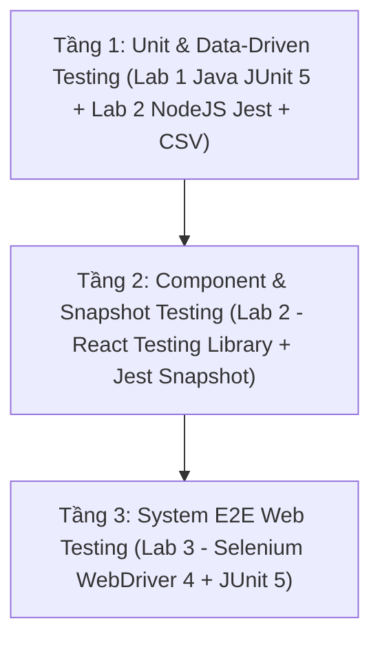

# LAB 4: ISTQB TEST PLAN & HỒ SƠ ỨNG DỤNG AI (HỆ THỐNG EGA AUTOCARE)

> **Mã tài liệu**: `TP-SWT-EGA-2026-V1.0`  
> **Chuẩn áp dụng**: **ISTQB Foundation Level / IEEE 829 / ISO/IEC/IEEE 29119-3**  
> **Hệ thống kiểm thử**: Hệ thống Thương mại Điện tử Phụ tùng & Dịch vụ Bảo dưỡng Ô tô **EGA Autocare** (`https://ega-autocare.mysapo.net/`)  
> **Phụ trách chính**: Thành viên 5 (M5) phối hợp cùng M1, M2, M3, M4  

---

## PHẦN A: NỘI DUNG CHI TIẾT ISTQB TEST PLAN (MỤC 1 → MỤC 9 & MỤC 10 → 12)

---

### 1. Test Plan Identifier (Mã Định Danh Kế Hoạch Kiểm Thử)

| Thuộc tính | Nội dung chi tiết |
| :--- | :--- |
| **Mã Kế hoạch Kiểm thử (Document ID)** | `TP-SWT-EGA-2026-V1.0` |
| **Tên Dự án / Hệ thống** | Hệ thống Phụ tùng & Bảo dưỡng Ô tô **EGA Autocare** |
| **Phiên bản (Version)** | `1.0 (Final Release)` |
| **Ngày ban hành** | `03/11/2026` |
| **Chuẩn tham chiếu** | ISTQB® CTFL Syllabus v4.0 & IEEE Std 829 / ISO/IEC/IEEE 29119-3 |
| **Tác giả & Nhóm thực hiện** | • **M1 (Leader)**: Phụ trách Lab 1 (JUnit 5) & Phê duyệt Test Plan • **M2**: Phụ trách Lab 2 (NodeJS / React / Jest) • **M3**: Phụ trách Lab 3 - Phần 1 (Selenium Access, Login, Search) • **M4**: Phụ trách Lab 3 - Phần 2 (Selenium Mua ≥ 3 SP, Tổng tiền Giỏ hàng) • **M5**: Phụ trách chính Lab 4 (ISTQB Test Plan, Hồ sơ AI & Chuẩn hóa Test Case Template) |

---

### 2. Introduction & Purpose (Giới Thiệu & Mục Đích)

#### 2.1. Giới thiệu bối cảnh dự án
**EGA Autocare** (`https://ega-autocare.mysapo.net/`) là hệ thống thương mại điện tử chuyên cung cấp phụ tùng, phụ kiện chăm sóc ô tô (bơm lốp Michelin, tinh dầu Areon, bạt phủ AutoGuard,...) kết hợp dịch vụ đặt lịch bảo dưỡng định kỳ tại gara. Để đảm bảo độ tin cậy tuyệt đối về mặt tính toán tài chính (chiết khấu, phí lắp đặt, phí vận chuyển, thuế GTGT), tính ổn định của các thành phần giao diện người dùng (UI Components) và sự thông suốt của luồng mua sắm trực tuyến, nhóm thực hiện chiến dịch kiểm thử phần mềm toàn diện theo chuẩn **ISTQB**.

#### 2.2. Mục đích của tài liệu
1. Xác định rõ phạm vi kiểm thử (In-Scope / Out-of-Scope) cho cả 3 cấp độ: **Unit Testing (Lab 1)**, **Component & Snapshot Testing (Lab 2)** và **System End-to-End Web Testing (Lab 3)**.
2. Quy định phương pháp thiết kế ca kiểm thử (Hộp trắng, Hộp đen, Data-Driven qua file CSV) nhằm đạt **100% Code Coverage** và **100% Test Automation**.
3. Thiết lập tiêu chí Đạt/Không đạt (Pass/Fail), điều kiện Tạm dừng/Tiếp tục (Suspension/Resumption) và danh mục Sản phẩm bàn giao (Test Deliverables) thống nhất cho toàn nhóm.

---

### 3. Test Items (Các Đối Tượng / Hạng Mục Kiểm Thử)

| Mã Hạng Mục | Tên Phân Hệ / Module | Công Nghệ & Phiên Bản | Đường Dẫn Mã Nguồn Trong Repository |
| :---: | :--- | :--- | :--- |
| **TI-01** | **Phân hệ Tính Hóa Đơn Phụ Tùng & Lắp Đặt (`EgaAutocareBillingService`)** | Java 17, Maven 3.9, JUnit 5.10.2, JaCoCo 0.8.12 | `Lab1_JUnit5/src/main/java/com/mycompany/lab1/EgaAutocareBillingService.java` |
| **TI-02** | **Phân hệ UI Component & Tính Hóa Đơn Dịch Vụ Bảo Dưỡng** | Node.js, React 18.2, Jest 29.7, React Testing Library 14.2 | `Lab2_NodeJS/src/components/*.jsx` `Lab2_NodeJS/src/services/discountService.js` `Lab2_NodeJS/src/utils/csvLoader.js` |
| **TI-03** | **Phân hệ Website Thương Mại Điện Tử EGA Autocare (Storefront)** | Nền tảng Sapo Web (`https://ega-autocare.mysapo.net/`), Selenium 4.25.0 | `Lab3_Selenium_EGA_Autocare/src/test/java/com/mycompany/egaautocare/EgaAutocareTest.java` |

---

### 4. Features to be Tested (Các Tính Năng Được Kiểm Thử)

| Mã Tính Năng | Tên Tính Năng & Mô Tả Nghiệp Vụ | Cấp Độ Kiểm Thử | Trọng Số / Ưu Tiên | Mã Test Case Liên Kết |
| :---: | :--- | :---: | :---: | :--- |
| **FT-01** | Kiểm tra tính hợp lệ đầu vào đơn hàng (`isValidOrderInput`: số lượng `1..100`, đơn giá `> 0`, khoảng cách `>= 0`) | Unit Test (Lab 1) | Cao (High) | `UT_L1_01_01` → `UT_L1_01_08` |
| **FT-02** | Tính tiền phụ tùng theo bậc chiết khấu số lượng (`calculatePartsSubtotal`: mua `>= 10` giảm 10%, `>= 4` giảm 5%) | Unit Test (Lab 1) | Cao (High) | `UT_L1_02_01` → `UT_L1_02_06` |
| **FT-03** | Tính phí công lắp đặt tại gara theo gói (`calculateInstallationFee`: `NONE`, `PREMIUM`, `STANDARD`, `BASIC`) | Unit Test (Lab 1) | Trung bình | `UT_L1_03_01` → `UT_L1_03_05` |
| **FT-04** | Tính chiết khấu hạng thẻ thành viên (`calculateMemberDiscount`: `VIP` 15%, `GOLD` 10%, `SILVER` 5%, `REGULAR` 0%) | Unit Test (Lab 1) | Cao (High) | `UT_L1_04_01` → `UT_L1_04_06` |
| **FT-05** | Tính phí vận chuyển (`calculateShippingFee`: miễn phí khi nhận tại gara hoặc đơn sau giảm `>= 2.000.000đ`) | Unit Test (Lab 1) | Trung bình | `UT_L1_05_01` → `UT_L1_05_05` |
| **FT-06** | Tính thuế GTGT 8% khi yêu cầu xuất hóa đơn (`calculateVatTax`) & Tổng hợp hóa đơn liên hoàn 7 hàm (`calculateFinalInvoiceTotal`, giảm thêm `200k` cho đơn `>= 10 triệu`) | Unit Test & Integration (Lab 1) | Rất cao (Critical) | `UT_L1_06_01` → `UT_L1_07_05` |
| **FT-07** | Tương tác nút Đặt lịch bảo dưỡng xe (`ServiceBookingButton`: giảm slot, sinh mã `EGA-1001`, vô hiệu hóa nút khi `slots = 0`, nút Reset) | Component Test (Lab 2) | Cao (High) | `TC01_Test_Button` (6 test methods) |
| **FT-08** | Hiển thị chuỗi thông báo khách hàng, hạng thẻ, quy đổi điểm thưởng, cảnh báo bảo dưỡng & thông báo đặc biệt (`MembershipGreetingBanner`) | Component CSV Test (Lab 2) | Cao (High) | `TC_GREET_01` → `TC_GREET_05` |
| **FT-09** | Đóng băng và kiểm tra hồi quy cấu trúc DOM của thẻ dịch vụ (`AutoServiceCard`: gói mặc định, gói Hot giảm giá, gói thường) | Snapshot Test (Lab 2) | Trung bình | `TC03_Snapshot` (3 Snapshots) |
| **FT-10** | Tính hóa đơn dịch vụ bảo dưỡng (`calculateServiceInvoice`: kiểm tra ngoại lệ, mã voucher `EGAMEGA`/`EGASUPER`/`EGAFREE`, ưu đãi khách mới 5%, trần giảm giá tối đa 50%, VAT 10%) | Unit CSV Test (Lab 2) | Rất cao (Critical) | `TC_DISC_01` → `TC_DISC_ERR_02` |
| **FT-11** | Truy cập trang chủ `ega-autocare.mysapo.net`, Đăng nhập thành công (`linhcampochia@gmail.com`) và Đăng nhập thất bại với tài khoản chưa đăng ký | System E2E Test (Lab 3) | Rất cao (Critical) | `ST_L3_001` → `ST_L3_003` |
| **FT-12** | Tìm kiếm sản phẩm phụ tùng (`"bơm lốp"`), Mua ít nhất 3 sản phẩm khác nhau và Kiểm tra tổng giá tiền giỏ hàng (`1.915.000₫`) | System E2E Test (Lab 3) | Rất cao (Critical) | `ST_L3_004` → `ST_L3_006` |

---

### 5. Features NOT to be Tested (Các Tính Năng Ngoài Phạm Vi Kiểm Thử)

Để tập trung nguồn lực vào các yêu cầu cốt lõi của bài Lab và tránh tác động xấu lên môi trường vận hành thực tế của cửa hàng, các tính năng sau nằm ngoài phạm vi kiểm thử:
1. **Thanh toán thực tế qua cổng ngân hàng / ví điện tử (Payment Gateway Execution)**: Không thực hiện bấm hoàn tất đặt hàng (Submit Order) ở bước cuối thanh toán để tránh tạo đơn hàng rác cho hệ thống thực tế `ega-autocare.mysapo.net`.
2. **Kiểm thử hiệu năng và chịu tải (Performance / Load / Stress Testing)**: Không thực hiện giả lập hàng ngàn người dùng truy cập đồng thời vào máy chủ Sapo.
3. **Kiểm thử bảo mật chuyên sâu (Penetration Testing / SQL Injection / DDoS)**: Chỉ kiểm tra xác thực đăng nhập cơ bản (`TC02`, `TC03`), không thực hiện tấn công thử nghiệm lên hạ tầng đám mây của Sapo.
4. **Phân hệ Quản trị Nội bộ (Sapo Admin CMS & Quản lý Kho)**: Nhóm kiểm thử ở góc độ người dùng cuối (Customer Storefront) và các dịch vụ tính toán độc lập.

---

### 6. Approach / Test Strategy (Phương Pháp Tiếp Cận & Chiến Lược Kiểm Thử)

Chiến lược kiểm thử được thiết kế theo mô hình **Kim tự tháp Kiểm thử (Testing Pyramid)** kết hợp **100% Tự động hóa (Full Test Automation)**:

1. **Kỹ thuật Kiểm thử Hộp trắng (White-Box Testing)**:
   - Áp dụng tiêu chuẩn **100% Statement Coverage** (mọi câu lệnh đều được thực thi ít nhất 1 lần) và **100% Branch/Decision Coverage** (mọi nhánh `true`/`false` của tất cả điều kiện `if - else if - else` và toán tử logic `||`, `&&` đều được kiểm thử).
   - Công cụ đo lường tự động: **JaCoCo Maven Plugin `0.8.12`** (cho Java Lab 1) và **Jest Coverage Engine** với cấu hình `coverageThreshold = 100%` (cho NodeJS Lab 2).
2. **Kỹ thuật Kiểm thử Hộp đen (Black-Box Testing)**:
   - **Phân vùng tương đương (Equivalence Partitioning - EP)**: Chia dữ liệu thành các vùng hợp lệ (số lượng `1..3`, `4..9`, `10..100`, hạng thẻ `VIP`/`GOLD`/`SILVER`/`REGULAR`) và vùng không hợp lệ (`<= 0`, `> 100`, đơn giá âm, hạng thẻ không tồn tại `PLATINUM`).
   - **Phân tích giá trị biên (Boundary Value Analysis - BVA)**: Kiểm thử sát các điểm biên nhạy cảm (`itemQuantity = 0, 1, 4, 10, 100, 101`; `distanceKm = 0, 10`; mốc miễn phí vận chuyển `2.000.000đ`; mốc hóa đơn lớn `10.000.000đ`; trần chiết khấu `50%`).
3. **Kiểm thử Hướng dữ liệu (Data-Driven Testing - DDT qua file CSV)**:
   - Không gán cứng (hard-code) bộ dữ liệu trong mã nguồn test. Toàn bộ dữ liệu đầu vào và kết quả kỳ vọng được tách riêng vào các file `.csv` (`valid_order_input.csv`, `parts_subtotal.csv`, ..., `discount_test_data.csv`, `greeting_test_data.csv`) và nạp động vào hàm test.
4. **Kiểm thử Giao diện Tự động (Selenium WebDriver E2E)**:
   - Sử dụng **Selenium 4.25.0** (tích hợp sẵn *Selenium Manager* tự động đồng bộ ChromeDriver theo phiên bản Chrome trên máy).
   - Sử dụng `WebDriverWait` (`ExpectedConditions`) để đồng bộ hóa trạng thái tải trang và thuật toán bóc tách chuỗi tiền tệ (`replaceAll("[^0-9]", "")`) để đối chiếu tổng giá trị giỏ hàng chính xác tuyệt đối.

---

### 7. Item Pass/Fail Criteria (Tiêu Chí Đạt / Không Đạt)

#### 7.1. Tiêu chí Đạt (Pass Criteria) cho từng Hạng mục
| Hạng mục | Tiêu chí Thực thi (Execution) | Tiêu chí Độ phủ (Coverage) | Tiêu chí Báo cáo & Tài liệu |
| :--- | :--- | :--- | :--- |
| **Lab 1 (JUnit 5)** | **39/39** test cases chạy tự động `Pass` (`0 Failures, 0 Errors`) | **100%** Instructions (`225/225`) **100%** Branches (`46/46`) **100%** Methods (`8/8`) | Có báo cáo HTML JaCoCo + Surefire và file `TestCase_Lab1_JUnit5.xls` |
| **Lab 2 (NodeJS)** | **41/41** test cases & **3/3** Snapshots chạy `Pass` | **100%** Statements (`143/143`) **100%** Branches (`113/113`) **100%** Functions & Lines | Có báo cáo LCOV HTML + Jest Report và file `TestCase_Lab2_NodeJS.xls` |
| **Lab 3 (Selenium)** | **6/6** kịch bản E2E chạy tự động liên hoàn `Pass` trên `ega-autocare.mysapo.net` | Bao phủ 100% 6 yêu cầu chức năng từ `(i)` đến `(vi)` của đề bài | Tổng tiền 3 sản phẩm khớp đúng `1.915.000₫`; có `TestCase_Lab3_Selenium.xls` |

#### 7.2. Tiêu chí Không đạt (Fail Criteria)
- Bất kỳ ca kiểm thử tự động nào trả về trạng thái `Failed` hoặc `Error`.
- Chỉ số `Branch Coverage` hoặc `Statement Coverage` trong báo cáo JaCoCo / Jest đạt dưới `100%`.
- Kịch bản Selenium không tự động lấy được giá trị thực tế từ giao diện web hoặc sử dụng điều kiện kiểm tra giả (assertion luôn đúng).

---

### 8. Suspension Criteria and Resumption Requirements (Tiêu Chí Tạm Dừng & Điều Kiện Tiếp Tục)

#### 8.1. Tiêu chí Tạm dừng (Suspension Criteria)
1. **Sự cố môi trường mạng hoặc máy chủ Web (Lab 3)**: Website `https://ega-autocare.mysapo.net/` không thể truy cập (Timeout > 30 giây, lỗi HTTP 500/502/503) hoặc bật cơ chế chặn Captcha tự động trên trang đăng nhập.
2. **Thay đổi dữ liệu sản phẩm trên trang đích**: Một trong 3 sản phẩm mẫu (`/michelin-m2566-bom-lop`, `/areon-tinh-dau-treo-xe`, `/autoguard-bat-phu-xe`) bị ẩn hoặc chuyển sang trạng thái *"Hết hàng"* trên hệ thống Sapo.
3. **Lỗi cấu hình môi trường Build (Lab 1 & Lab 2)**: Lỗi thiếu thư viện Maven (`.m2`) hoặc `node_modules` làm dừng quá trình biên dịch trước khi test chạy.

#### 8.2. Điều kiện Tiếp tục (Resumption Requirements)
1. Đường truyền mạng và website `ega-autocare.mysapo.net` hoạt động ổn định trở lại (`test01_AccessWeb` chạy Pass).
2. Nếu sản phẩm mẫu trên web hết hàng, nhóm cập nhật lại đường dẫn slug của sản phẩm còn hàng tương đương trong mảng `productSlugs` và chạy lại từ `TC01` → `TC06`.
3. Môi trường JDK / Maven / Node.js được khôi phục và biên dịch thành công (`mvn test-compile` / `npm test`).

---

### 9. Test Deliverables (Các Sản Phẩm Bàn Giao)

| STT | Tên Sản Phẩm Bàn Giao (Deliverable) | Định Dạng | Vị Trí Lưu Trữ Trong Repository | Trạng Thái |
| :---: | :--- | :---: | :--- | :---: |
| **1** | Mã nguồn 7 hàm Java + Bộ Unit Test JUnit 5 + 7 file CSV + Báo cáo JaCoCo 100% | `.java`, `.csv`, `.html`, `.xml` | `Lab1_JUnit5/` | Hoàn thành |
| **2** | Tài liệu Đặc tả Test Case Lab 1 (7 Sheet cho 7 hàm) | `.xls` | `Lab1_JUnit5/TestCase_Lab1_JUnit5.xls` | Hoàn thành |
| **3** | Mã nguồn React/NodeJS + Bộ Test Jest + 2 file CSV + Snapshot + Báo cáo Coverage 100% | `.jsx`, `.js`, `.csv`, `.snap`, `.html` | `Lab2_NodeJS/` | Hoàn thành |
| **4** | Tài liệu Đặc tả Test Case Lab 2 (4 Sheet cho Button, String, Snapshot, Hàm `if-else`) | `.xls` | `Lab2_NodeJS/TestCase_Lab2_NodeJS.xls` | Hoàn thành |
| **5** | Mã nguồn Selenium WebDriver (6 kịch bản E2E trên EGA Autocare) + Báo cáo Surefire | `.java`, `.xml`, `.txt` | `Lab3_Selenium_EGA_Autocare/` | Hoàn thành |
| **6** | Tài liệu Đặc tả Test Case Lab 3 (6 Sheet cho 6 luồng E2E) | `.xls` | `Lab3_Selenium_EGA_Autocare/TestCase_Lab3_Selenium.xls` | Hoàn thành |
| **7** | **Kế hoạch Kiểm thử chuẩn ISTQB (ISTQB Test Plan)** | `.docx`, `.md` | `Lab4_ISTQB_TestPlan/Lab4_ISTQB_TestPlan.docx` | Hoàn thành |
| **8** | **Hồ sơ Minh chứng Ứng dụng AI & Danh mục Prompt (10% điểm Barem Lab 4)** | `.docx`, `.md` | `Lab4_ISTQB_TestPlan/Lab4_AI_Application_Evidence.docx` | Hoàn thành |

---

### 10. Testing Tasks, Responsibilities & Schedule (Phân Công Nhiệm Vụ & Lịch Trình)

| Thành Viên | Vai Trò | Công Việc Phụ Trách Chính | Tiến Độ |
| :---: | :--- | :--- | :---: |
| **M1 (Leader)** | JUnit 5 Lead & Project Manager | Thiết kế 7 hàm `EgaAutocareBillingService`, viết JUnit 5 `@ParameterizedTest` đọc 7 file CSV, cấu hình JaCoCo 100%, nghiệm thu tổng thể | 100% |
| **M2** | NodeJS & Jest Lead | Xây dựng `ServiceBookingButton`, `MembershipGreetingBanner`, `AutoServiceCard`, `discountService`, đọc CSV và cấu hình Jest 100% Coverage | 100% |
| **M3** | Selenium Automation Lead (Phần 1) | Khởi tạo WebDriver, tài khoản test `linhcampochia@gmail.com` và tự động hóa 4 kịch bản: `Access`, `Login Đúng`, `Login Sai`, `Search` | 100% |
| **M4** | Selenium Automation Lead (Phần 2) | Tự động hóa kịch bản `Mua >= 3 sản phẩm khác nhau` và `Kiểm tra tổng tiền giỏ hàng (1.915.000₫)`, xuất báo cáo Surefire | 100% |
| **M5** | QA Documentation & ISTQB Lead | Soạn thảo tài liệu `Lab4_ISTQB_TestPlan.docx`, lưu hồ sơ Prompt AI và đồng bộ bộ 3 file `TestCaseTemplate.xls` | 100% |

---

### 11. Environmental Needs & Tools (Môi Trường & Công Cụ Kiểm Thử)
- **Hệ điều hành**: Windows 11 (64-bit).
- **Môi trường Lab 1 & Lab 3**: Java Development Kit (JDK 17 / JDK 21), Apache Maven `3.9.9`, Apache NetBeans IDE, JUnit Jupiter `5.10.2` / `5.6.0`, JaCoCo `0.8.12`, Selenium WebDriver `4.25.0`, trình duyệt Google Chrome.
- **Môi trường Lab 2**: Node.js `v24.x`, npm `11.x`, React `18.2.0`, Jest `29.7.0`, `@testing-library/react` `14.2.1`, Babel.
- **Hệ thống quản lý mã nguồn**: Git & GitHub (`https://github.com/ViktorWilson7777/SWT-Group-Labs`).

---

### 12. Risks & Contingencies (Quản Lý Rủi Ro & Phương Án Dự Phòng)

| Mã Rủi Ro | Mô Tả Rủi Ro Kỹ Thuật | Mức Độ | Phương Án Phòng Ngừa & Khắc Phục (Contingency Plan) |
| :---: | :--- | :---: | :--- |
| **R-01** | Biểu thức điều kiện kép (`\|\|`, `&&`) hoặc nhánh kiểm tra thừa làm độ phủ Branch Coverage bị hụt dưới 100% | Cao | Rà soát từng điều kiện bằng báo cáo HTML của JaCoCo/Jest; loại bỏ điều kiện kiểm tra trùng lặp và bổ sung đủ các dòng dữ liệu biên trong file CSV. |
| **R-02** | Khi đọc file CSV trong NodeJS, ô trống trả về chuỗi rỗng `""` hoặc khoảng trắng `"   "` thay vì `null` | Trung bình | Chuẩn hóa điều kiện kiểm tra bằng `str && str.trim() !== ""` trong cả component và hàm xử lý. |
| **R-03** | Selector CSS chung chung (`button[type='submit']`, `.price`) trên web Sapo bắt nhầm nút Tìm kiếm trên Header hoặc thẻ giá ẩn | Rất cao | Định danh phạm vi selector chặt chẽ (`#customer_login button.btn-login`, `span.price.text-h4`, `.cart-total .price`) và đọc `textContent` kết hợp `WebDriverWait`. |

---

## PHẦN B: LƯU TRỮ CÁC CÂU LỆNH PROMPT AI ĐÃ DÙNG (MINH CHỨNG 10% ĐIỂM AI - LAB 4)

Thực hiện theo mục `Note iii. Có thể sử dụng các công cụ AI để thực hiện` trong [LabTesting.txt](file:///c:/Users/DELL/Downloads/lab%20SWT/LabTesting.txt) và tiêu chí chấm **`AI (0.1 = 10% điểm)`** tại Sheet `Lab4` của file `barem lab.xlsx`, nhóm đã ứng dụng AI có kiểm soát và lưu lại toàn bộ lịch sử các câu lệnh **Prompt AI** cùng bước **Kiểm chứng & Hiệu chỉnh của con người (Human-in-the-Loop)** như sau:

### Prompt 1 — Phân tích Barem điểm & Lập kế hoạch phân công nhóm 5 người
- **Câu lệnh Prompt đã dùng**:
  > *"Dựa trên file yêu cầu `LabTesting.txt` (gồm 4 bài Lab: 1. JUnit5, 2. NodeJS, 3. Selenium web testing, 4. Viết test plan theo template của ISTQB) và file `barem lab.xlsx` đi kèm, hãy phân tích các tiêu chí chấm điểm của từng bài Lab và lập kế hoạch phân công chi tiết cho nhóm 5 thành viên (M1 → M5) sao cho cân bằng khối lượng công việc và đạt tối đa điểm số."*
- **Giá trị AI mang lại & Kiểm chứng của nhóm**:
  - AI giúp phát hiện kịp thời rằng ở **Sheet `Lab2` (NodeJS)** trong `barem lab.xlsx` có chấm **20% Dùng CSV** và **10% Cover code** (dù đề chữ không ghi rõ), và ở **Sheet `Lab4`** có chấm **10% AI**. Nhờ đó nhóm bổ sung ngay CSV và Coverage 100% vào bài NodeJS để không bị mất 30% điểm.

### Prompt 2 — Thiết kế 7 hàm Java liên kết nhau & Bộ dữ liệu CSV đạt 100% JaCoCo Branch Coverage (Lab 1)
- **Câu lệnh Prompt đã dùng**:
  > *"Hãy thiết kế class Java `EgaAutocareBillingService` theo chủ đề Hệ thống Phụ tùng & Bảo dưỡng Ô tô EGA Autocare gồm đúng 7 hàm liên quan chặt chẽ với nhau (Hàm 7 gọi liên hoàn từ Hàm 1 đến Hàm 6), mỗi hàm có ít nhất 1 cấu trúc điều kiện `if-else`, chỉ sử dụng kiểu dữ liệu nguyên thủy/String để nạp trực tiếp từ `@CsvFileSource` trong JUnit 5. Đồng thời sinh bộ dữ liệu test trong 7 file `.csv` bao phủ 100% cả Instruction Coverage và Branch Coverage trên JaCoCo."*
- **Kiểm chứng & Hiệu chỉnh của nhóm**:
  - Chạy kiểm chứng thực tế bằng lệnh `mvn clean test` với `jacoco-maven-plugin 0.8.12`: Đạt chính xác **39/39 test cases Pass**, `0 missed instructions (225/225)` và `0 missed branches (46/46)`.

### Prompt 3 — Rà soát lỗi Logic & Bẫy "Nhánh chết (Unreachable Code)" trong thiết kế NodeJS/Jest (Lab 2)
- **Câu lệnh Prompt đã dùng**:
  > *"Đây là bảng thiết kế 4 thành phần/hàm NodeJS & React (`ServiceBookingButton`, `MembershipGreetingBanner`, `AutoServiceCard`, `calculateServiceInvoice`) của Thành viên 2. Hãy đóng vai trò QA Lead rà soát xem có lỗi logic nghiệp vụ, bẫy đọc chuỗi rỗng từ file CSV hay nhánh chết (Unreachable Branch) nào làm cản trở việc đạt 100% Branch Coverage trong Jest hay không."*
- **Kiểm chứng & Hiệu chỉnh của nhóm**:
  - Phát hiện và sửa 3 lỗi quan trọng trước khi chốt code:
    1. Chỉnh lại bậc thang điều kiện Voucher (`EGAFREE >= 300k` → giảm `50k`, `EGASUPER >= 500k` → giảm `100k`, `EGAMEGA >= 1.000.000đ` → giảm `300k`) để vừa thuận chiều logic thực tế, vừa kích hoạt được nhánh khống chế trần giảm giá 50% (`isCapped = true`).
    2. Gộp kiểm tra `customerTier` vào 1 khối `if - else if - else` duy nhất để loại bỏ nhánh chết.
    3. Thêm `.trim() !== ''` khi kiểm tra `customerName` và `customAnnouncement` đọc từ CSV.

### Prompt 4 — Khảo sát cấu trúc DOM thực tế & Khắc phục lỗi Selector Selenium trên `ega-autocare.mysapo.net` (Lab 3)
- **Câu lệnh Prompt đã dùng**:
  > *"Kiểm tra cấu trúc HTML thực tế của trang đăng nhập `/account/login`, trang sản phẩm và trang giỏ hàng `/cart` trên `https://ega-autocare.mysapo.net/`. Viết 6 hàm JUnit 5 Selenium (`@Order(1)` đến `@Order(6)`) cho 6 yêu cầu: Access web, Login đúng, Login sai (chưa có tài khoản), Tìm kiếm, Mua ít nhất 3 sản phẩm khác nhau và Kiểm tra tổng giá tiền giỏ hàng khớp chính xác 100%."*
- **Kiểm chứng & Hiệu chỉnh của nhóm**:
  - Khi chạy thử trên trình duyệt thật, nhóm phát hiện selector `button[type='submit']` bị bấm nhầm vào nút Tìm kiếm trên thanh Header thay vì nút Đăng nhập, và `span.price` đầu tiên nằm trong khối ẩn làm `visibilityOfElementLocated` bị Timeout.
  - Nhóm đã tinh chỉnh lại selector thành `#customer_login button.btn-login`, lấy giá sản phẩm qua `span.price.text-h4`, chọn mua 3 sản phẩm khác nhau (`/michelin-m2566-bom-lop` `1.180.000₫` + `/areon-tinh-dau-treo-xe` `285.000₫` + `/autoguard-bat-phu-xe` `450.000₫`) và dùng `assertEquals(expectedTotal, actualTotal)` xác nhận tổng giỏ hàng đúng **`1.915.000 VND`**.

### Prompt 5 — Soạn thảo Kế hoạch Kiểm thử chuẩn Quốc tế ISTQB / IEEE 829 (Lab 4)
- **Câu lệnh Prompt đã dùng**:
  > *"Dựa trên toàn bộ thông số kỹ thuật thực tế đã triển khai ở Lab 1 (`EgaAutocareBillingService` - 39 test cases CSV), Lab 2 (`Lab2_NodeJS` - 41 test cases Jest & 3 Snapshots) và Lab 3 (`EgaAutocareTest` - 6 kịch bản Selenium trên `ega-autocare.mysapo.net`), hãy soạn thảo tài liệu ISTQB Test Plan đầy đủ các mục chuẩn IEEE 829 (Test Plan Identifier, Introduction, Test Items, Features to be Tested, Features NOT to be Tested, Approach/Strategy, Pass/Fail Criteria, Suspension/Resumption Criteria, Test Deliverables, Schedule, Environment, Risks) cho hệ thống EGA Autocare."*
- **Kiểm chứng & Hiệu chỉnh của nhóm**:
  - Nhóm rà soát toàn bộ mã định danh Test Case (`UT_L1_...`, `TC_GREET_...`, `TC_DISC_...`, `ST_L3_...`), số liệu Coverage và tên file bàn giao trong Test Plan để đảm bảo khớp 100% với code thực tế trong Repository.
